# SenseVoice frontend: kaldi fbank + LFR + CMVN

This document describes, step by step, how SenseVoiceSmall (FunASR) turns a waveform into
its encoder input, and how `asrfront.sensevoice.fbank` reproduces it. The reference is
FunASR's `WavFrontend` (`funasr/frontends/wav_frontend.py`), which calls
`torchaudio.compliance.kaldi.fbank` and then applies low frame rate stacking (LFR) and
CMVN:

```python
import asrfront

feat = asrfront.sensevoice.fbank(audio, cmvn="SenseVoiceSmall/am.mvn")  # (T', 560)
```

## Overview

```mermaid
flowchart LR
    A["waveform<br/>16 kHz mono, [-1, 1]"] --> B["× 32768"]
    B --> C["frames 400, hop 160<br/>snip_edges"]
    C --> D["(dither)"]
    D --> E["remove DC"]
    E --> F["pre-emphasis 0.97"]
    F --> G["× Hamming"]
    G --> H["zero-pad 512<br/>rFFT, |X|²"]
    H --> I["kaldi mel<br/>80 bins, 20–8000 Hz"]
    I --> J["ln(max(·, ε))"]
    J --> K["LFR<br/>stack 7, step 6"]
    K --> L["CMVN<br/>(x + shift) · scale"]
```



`WavFrontend` configuration used by SenseVoiceSmall:

| Parameter | Value |
|---|---|
| `fs` | 16 000 Hz |
| `window` | `hamming` |
| `n_mels` | 80 |
| `frame_length` / `frame_shift` | 25 ms (400) / 10 ms (160) |
| `lfr_m` / `lfr_n` | 7 / 6 |
| `cmvn_file` | `am.mvn` shipped with the model |
| `upsacle_samples` | True (×32768) |
| Output | float32 `(ceil(T / 6), 560)` |

and the `kaldi.fbank` options it passes (everything else at Kaldi defaults):

| Option | Value | Effect |
|---|---|---|
| `num_mel_bins` | 80 | |
| `frame_length`, `frame_shift` | 25, 10 | 400 / 160 samples |
| `dither` | 0.0 for deterministic inference (see [Dither](#dither)) | |
| `energy_floor` | 0.0 | only affects the (unused) energy feature |
| `window_type` | `hamming` | |
| `sample_frequency` | 16000 | |
| `snip_edges` | True (default) | no padding, only complete frames |
| `remove_dc_offset` | True (default) | |
| `preemphasis_coefficient` | 0.97 (default) | |
| `round_to_power_of_two` | True (default) | FFT size 512 |
| `low_freq`, `high_freq` | 20, 0 (default) | 20 Hz … Nyquist |
| `use_energy`, `use_log_fbank`, `use_power` | False, True, True (defaults) | |

## 1. Scale to the int16 range

```python
waveform = waveform * (1 << 15)
```

Kaldi features are defined on int16-scale samples, so FunASR multiplies the float waveform by
32768 before feature extraction. This shifts every log-mel value by `ln(32768²) ≈ 20.8` and is
therefore *not* optional: CMVN statistics in `am.mvn` assume it. `asrfront` takes float audio
in [-1, 1] (or int16 PCM, which it converts to [-1, 1] first) and applies the ×32768 itself.

## 2. Framing (`snip_edges=True`)

```
T = 1 + (N − 400) // 160        if N ≥ 400, else 0
frame t = samples [160 t, 160 t + 400)
```

No padding: only complete frames are produced and the tail (< 160 samples) is discarded.
30 s (480 000 samples) gives T = 2998. Inputs shorter than 400 samples (25 ms) give no
frames at all — `asrfront` returns empty `(0, 80)` / `(0, 560)` arrays; FunASR's LFR step
would fail on that input.

## 3. Per-frame preprocessing

Each 400-sample frame `x` goes through, in this order:

1. **Dither** (if `dither > 0`): `x += dither · N(0, 1)` per sample.
2. **DC removal**: `x −= mean(x)` (mean of the frame).
3. **Pre-emphasis** (coefficient 0.97), computed on the DC-removed frame with the first
   sample replicated:

   ```
   y[0] = x[0] − 0.97 · x[0]
   y[k] = x[k] − 0.97 · x[k−1],   k = 1 … 399
   ```

   A first-order high-pass: −30.5 dB at DC, +5.9 dB at 8 kHz.
4. **Hamming window**, **symmetric** (denominator `N − 1`, unlike Whisper's periodic Hann):

   ```
   w[n] = 0.54 − 0.46 · cos(2π n / 399),   n = 0 … 399
   ```

5. **Zero-pad** to 512 (`round_to_power_of_two`).

The raw log energy (`use_energy`) is computed by Kaldi between steps 2 and 3 but is not used.

## 4. Power spectrum

512-point real FFT → 257 bins (`k = 0 … 256`, 31.25 Hz apart), power `|X|²`
(`use_power=True`). No normalization.

## 5. Kaldi mel filter bank

Kaldi uses the HTK-style mel scale with a natural log:

```
mel(f) = 1127 · ln(1 + f / 700)
```

- `low_freq = 20` Hz, `high_freq = 0` → Nyquist (8000 Hz): mel 31.7486 … 2840.0377.
- 82 points equally spaced in mel (`Δ = 34.6702`); filter `m` has left / center / right
  edges at points `m`, `m + 1`, `m + 2`.
- The triangles are evaluated **in the mel domain** at the mel value of each FFT bin
  frequency `31.25 k` (`k = 0 … 255`):
  `w_m(k) = max(0, min((mel_k − left) / (center − left), (right − mel_k) / (right − center)))`.
- **No area normalization** (peak 1 for every filter), unlike Whisper's Slaney filters.
- The Nyquist bin (k = 256) always has weight 0.

| | value |
|---|---|
| first centers (Hz) | 42.5, 65.7, 89.6, … |
| last center (Hz) | 7736.4 |
| non-zero bins per filter | 1 – 16 (501 total) |

torchaudio builds this matrix in float32 (mel values around 2800 lose ~1e-4 absolute
precision, giving filter weights off by up to 1.4e-5). `asrfront` computes it in double and
rounds once.

## 6. Log

```python
mel_energies = torch.max(mel_energies, torch.finfo(torch.float).eps).log()
```

Natural log with a floor at `FLT_EPSILON = 1.1920929e-07`, i.e. `ln ε = −15.9424`.
Digital silence therefore yields −15.9424 in every bin (with `dither = 0`).

For the JFK speech sample, values span 11.2 … 22.1 (5th–95th percentile, max 27.6); the
×32768 scaling contributes ~20.8 of that.

Result: raw fbank `(T, 80)`. This is what `asrfront.sensevoice.fbank_raw` returns.

## 7. LFR — low frame rate stacking

```python
def apply_lfr(inputs, lfr_m=7, lfr_n=6):
    T = inputs.shape[0]
    T_lfr = int(np.ceil(T / lfr_n))
    left_padding = inputs[0].repeat((lfr_m - 1) // 2, 1)  # 3 copies of frame 0
    inputs = torch.vstack((left_padding, inputs))
    T = T + (lfr_m - 1) // 2
    for i in range(T_lfr):
        if lfr_m <= T - i * lfr_n:
            LFR_inputs.append(inputs[i * lfr_n : i * lfr_n + lfr_m].view(1, -1))
        else:  # last frame: pad with the final frame
            num_padding = lfr_m - (T - i * lfr_n)
            frame = inputs[i * lfr_n :].view(-1)
            for _ in range(num_padding):
                frame = torch.hstack((frame, inputs[-1]))
            LFR_inputs.append(frame)
```

Every 6th frame, 7 consecutive frames are concatenated (frame-major) into one 560-dim
vector. Equivalently, output row `i` contains raw frames

```
clamp(6 i − 3 + j, 0, T − 1),   j = 0 … 6
```

— i.e. frames `6i − 3 … 6i + 3` centered on frame `6i`, with frame 0 repeated before the start
and frame `T − 1` repeated after the end.

| Row | Raw frames (T = 14) |
|---|---|
| 0 | 0 0 0 **0** 1 2 3 |
| 1 | 3 4 5 **6** 7 8 9 |
| 2 | 9 10 11 **12** 13 13 13 |

Effects: frame rate 100 Hz → 16.7 Hz (60 ms per output frame), each output frame sees 7 raw
frames (85 ms of audio); `T' = ceil(T / 6)`, so 30 s → 500 frames of 560 dims.

## 8. CMVN

```python
def apply_cmvn(inputs, cmvn):  # cmvn = [means; vars] from am.mvn
    inputs += cmvn[0:1, :dim]
    inputs *= cmvn[1:2, :dim]
```

Global (not per-utterance) mean/variance normalization with precomputed statistics stored
as a Kaldi nnet1 text file `am.mvn`:

```
<Nnet>
<Splice> 560 560
[ 0 ]
<AddShift> 560 560
<LearnRateCoef> 0 [ -8.311879 -8.600912 ... ]      ← shift = −mean
<Rescale> 560 560
<LearnRateCoef> 0 [ 0.155... ... ]                  ← scale = 1 / std
</Nnet>
```

`features = (x + shift) · scale`. FunASR's loader takes the tokens between `[` and `]` on
the line following `<AddShift>` / `<Rescale>`; the vectors are 560-dim, i.e. applied
**after** LFR. In SenseVoiceSmall's file the 560 values are the same 80-dim statistics
repeated 7 times (shift −15.05 … −8.31, scale 0.144 … 0.156), so the result is
≈ zero-mean, unit-variance features.

`asrfront.sensevoice.load_cmvn(path)` implements the same parser (with errors for malformed
files), and `fbank(..., cmvn=path_or_(shift, scale))` applies it. If the vectors are longer
than `n_mels · lfr_m`, only the first entries are used, as in FunASR.

## Dither

Kaldi's `dither` adds Gaussian noise (std = `dither`, in int16 units) to every sample before
DC removal; its purpose is to avoid `log(0)` on digital silence during training. FunASR's
`WavFrontend` default is `dither=1.0`; for inference you usually want the deterministic
`dither=0`, which is `asrfront`'s default — check your model configuration if you need to
match it exactly.

With `dither > 0` the features are random. `asrfront` draws the noise from its own
generator (splitmix64-seeded xorshift64*, Box–Muller), **reseeded from `seed` on every call**,
so the same input and seed always produce the same output. It does not reproduce torch's
random numbers.

## Edge cases

| Input | FunASR | `asrfront.sensevoice.fbank` |
|---|---|---|
| < 400 samples | 0 raw frames, LFR fails | `(0, 560)` (`fbank_raw`: `(0, 80)`) |
| 400 samples | 1 raw frame → 1 LFR frame (frame 0 × 7) | same |
| tail < 160 samples | dropped (`snip_edges`) | same |
| NaN / inf samples | NaN in the frames containing them | `ValueError` |
| int16 PCM | caller converts | divided by 32768, then ×32768 again (exact) |
| batch | `pad_sequence` with 0, plus lengths | `fbank_batch` → `(feats, lengths)`, zero-padded |

## How asrfront computes it

`csrc/sensevoice.c`, 8 frames at a time:

1. **Gather** 8 frames with an 8×8 register transpose, scaling by 32768 on the way
   (`gather_scaled`); dither, if enabled, is added lane by lane in frame order.
2. **`kaldi_prep`** — per-lane mean accumulated in double (sequentially, like a per-frame
   loop), DC removal, pre-emphasis, Hamming window and zero padding, written directly as the
   packed even/odd input of the FFT.
3. **FFT** — 512-point real FFT as a 256-point complex FFT (Stockham, radix 4⁴) plus the
   split step, fused with `|X|²`.
4. **Mel** (sparse ranges) and **ln** (vectorized Cephes `logf`, floor `FLT_EPSILON`),
   transposed into the `(T, 80)` raw buffer.
5. **LFR + CMVN** — row `i` copies the 7 clamped raw frames and applies
   `(x + shift) · scale`.

As for Whisper, there is no FMA or reassociation, so all kernel builds (AVX2, SSE2/NEON,
plain C) give bit-identical results.

## Accuracy

Against a float64 NumPy port of `kaldi.fbank` + `apply_lfr` + `apply_cmvn`
(`tests/python/reference.py`), 16 test signals:

| | max abs error |
|---|---|
| raw fbank, worst signal (chirp) | 7.7e-4 (log domain) |
| raw fbank, speech | 2.0e-4 |
| final features with SenseVoiceSmall's `am.mvn` | 1.1e-4 |
| vs. torchaudio's float32 `kaldi.fbank` | ≤ 2e-3 |

The largest raw errors occur in the lowest mel bins of signals whose energy there is
≈ 30 dB below the frame peak (pre-emphasis attenuates low frequencies), where float32
rounding relative to the peak dominates. CMVN scales by ≈ 0.15, so the model-facing
features are accurate to ~1e-4. The float64 reference itself matches torchaudio to 1e-6 when
given torchaudio's filter bank, i.e. the algorithms are identical; the residual differences
to torchaudio come from its float32 filter bank and FFT.
