# Whisper frontend: log-mel spectrogram

This document describes, step by step, how Whisper turns a waveform into its encoder input,
and how `asrfront.whisper.log_mel` reproduces it. The reference is
`whisper/audio.py` in [openai/whisper](https://github.com/openai/whisper):

```python
mel = whisper.log_mel_spectrogram(whisper.pad_or_trim(audio), n_mels=80)  # (80, 3000)
```

```python
import asrfront

mel = asrfront.whisper.log_mel(audio)  # same thing
```

## Overview

```mermaid
flowchart LR
    A["waveform<br/>16 kHz mono"] --> B["pad / trim<br/>to 480 000 samples"]
    B --> C["reflect pad<br/>200 | 200"]
    C --> D["frames<br/>400, hop 160"]
    D --> E["× periodic Hann"]
    E --> F["rFFT 400<br/>|X|² → 201 bins"]
    F --> G["drop last frame<br/>3001 → 3000"]
    G --> H["mel filters<br/>slaney, 80/128"]
    H --> I["log10(max(·, 1e-10))"]
    I --> J["max(·, max − 8)"]
    J --> K["(· + 4) / 4"]
```



| Parameter | Value |
|---|---|
| Sample rate | 16 000 Hz (input must already be 16 kHz mono) |
| Chunk | 30 s = 480 000 samples (`N_SAMPLES`) |
| FFT size / window length | 400 samples (25 ms) |
| Hop | 160 samples (10 ms) |
| Window | Hann, **periodic** |
| STFT | `center=True`, **reflect** padding |
| Frequency bins | 201 (0 … 8000 Hz, 40 Hz apart) |
| Mel bins | 80 (all models up to large-v2), 128 (large-v3 / turbo) |
| Output | float32 `(n_mels, 3000)` |

## 1. Pad or trim to 30 s

```python
def pad_or_trim(array, length=480000):
    if array.shape[-1] > length:
        array = array[..., :length]  # keep the first 30 s
    if array.shape[-1] < length:
        array = F.pad(array, (0, length - array.shape[-1]))  # zeros at the end
    return array
```

The encoder always sees exactly 30 s. Shorter audio is zero-padded **at the end**; longer
audio is truncated (the transcription loop handles longer audio by sliding this window).

`asrfront` does this **virtually**: no padded copy is made. With `pad_or_trim=True` the signal
is treated as `v[i] = audio[i]` for `i < len(audio)`, `0` for `len(audio) ≤ i < 480000`, and
samples past 480 000 are never read.

## 2. Reflect padding (`center=True`)

`torch.stft(..., center=True)` pads `n_fft // 2 = 200` samples on both sides with
`pad_mode="reflect"`, so that frame `t` is **centered** on sample `t · 160`:

```
v[-k]         = v[k]                 (k = 1 … 200)      left edge
v[N - 1 + k]  = v[N - 1 - k]         (k = 1 … 200)      right edge
```

Reflection does not repeat the edge sample (`[a b c d] → [c b | a b c d | c b]`). With
`pad_or_trim` the right edge lies inside the zero padding, so the right reflection reflects
zeros; for real content it only matters at the very start of the clip.

Reflect padding requires `200 < N`. Torch raises an error otherwise; `asrfront` raises
`ValueError` for `pad_or_trim=False` with ≤ 200 samples (with `pad_or_trim=True` the
signal is always 480 000 samples long, even for empty input).

## 3. Framing and window

The padded signal has `N + 400` samples, giving `1 + N / 160` frames (`N // 160` for
lengths not divisible by 160, plus one). Frame `t` covers original samples
`[160 t − 200, 160 t + 200)` and is multiplied by a **periodic** Hann window:

```
w[n] = 0.5 − 0.5 · cos(2π n / 400),   n = 0 … 399        # torch.hann_window(400)
```

"Periodic" means the denominator is `N = 400`, not `N − 1` (the symmetric form). Σw² = 150.

## 4. Power spectrum

```python
stft = torch.stft(audio, 400, 160, window=window, return_complex=True)  # (201, 3001)
magnitudes = stft[..., :-1].abs() ** 2  # (201, 3000)
```

- 400-point real FFT → 201 bins `k = 0 … 200`, bin `k` at `40 k` Hz.
- Power, not magnitude (`|X|²`), no normalization by window energy.
- **The last frame is dropped**: 480 000 samples → 3001 frames → 3000. In general
  `n_frames = N // 160`.

## 5. Mel filter bank

```python
filters = mel_filters(device, n_mels)  # (n_mels, 201), loaded from assets/mel_filters.npz
mel_spec = filters @ magnitudes  # (n_mels, 3000)
```

The shipped `mel_filters.npz` was generated with
`librosa.filters.mel(sr=16000, n_fft=400, n_mels=n_mels)` — librosa's defaults:

- **Slaney mel scale** (`htk=False`): linear below 1 kHz, logarithmic above

  ```
  mel(f) = 3 f / 200                                   f < 1000 Hz
  mel(f) = 15 + 27 · ln(f / 1000) / ln(6.4)            f ≥ 1000 Hz
  ```

- `n_mels + 2` points equally spaced in mel between `fmin = 0` and `fmax = 8000` Hz
  (mel 0 … 45.2456), converted back to Hz: `f_0 … f_{n_mels+1}`.
- Filter `m` is a triangle rising from `f_m` to `f_{m+1}` and falling to `f_{m+2}`,
  evaluated at the FFT bin frequencies `40 k`:
  `w_m(f) = max(0, min((f − f_m) / (f_{m+1} − f_m), (f_{m+2} − f) / (f_{m+2} − f_{m+1})))`.
- **Slaney normalization** (`norm="slaney"`): each triangle is scaled by
  `2 / (f_{m+2} − f_m)` so every filter has (approximately) equal area. Low filters are
  narrow and tall (peak 0.0249 for 80 mels), high filters wide and short (0.0032).

Consequences worth knowing:

| | 80 mels | 128 mels |
|---|---|---|
| first centers (Hz) | 37.2, 74.5, 111.7, … | 23.4, 46.8, 70.2, … |
| last center (Hz) | 7698.6 | 7809.4 |
| non-zero bins per filter | 1 – 14 (391 total) | 1 – 9 (394 total) |

The lowest filters are narrower than the 40 Hz bin spacing, so they touch only one or two FFT
bins. The filter matrix is ~98 % zeros, which is why `asrfront` stores each filter as a
`(first bin, length, weights)` range.

`asrfront` does not ship the npz: it generates the filters in double precision following
librosa's exact rounding order (triangle rounded to float32, then multiplied by the float64
`enorm`, then rounded to float32), which makes them **bit-identical** to `mel_filters.npz` for
both 80 and 128 mels (tested).

## 6. Log compression and normalization

```python
log_spec = torch.clamp(mel_spec, min=1e-10).log10()
log_spec = torch.maximum(log_spec, log_spec.max() - 8.0)
log_spec = (log_spec + 4.0) / 4.0
```

1. **log10 with a floor** of 1e-10 (−100 dB): `log10(max(mel, 1e-10))`, range ≥ −10.
2. **Dynamic range clamp of 80 dB relative to the global maximum**: everything more than
   8 decades below the loudest mel value *of the whole 30 s spectrogram* is raised to
   `max − 8`. This is the only step that couples frames: the output of one frame depends
   on the loudest frame anywhere in the chunk, so features of a 30 s chunk cannot be
   computed independently per frame or streamed.
3. **Affine scaling** to roughly [−1, 1]: `(x + 4) / 4`.

Reference points:

- Digital silence: every mel value is 0 → log −10 everywhere → max −10 → output
  `(−10 + 4) / 4 = −1.5` everywhere.
- Zero padding after real speech: padded frames are 0 → clamped to `max − 8`, i.e. they
  sit exactly 8 decades below the loudest frame, output `(max − 4) / 4`.
- Loud content peaks around log10 ≈ 2 (JFK speech sample: 1.85 → output 1.46; a clipped
  full-scale tone: 2.45 → 1.61). With the 8-decade clamp, outputs therefore lie in roughly
  [max − 2, max] ⊂ [−1.5, 1.7].

## 7. Output

`(n_mels, n_frames)` float32, row-major (frequency-major), `n_frames = 3000` with
`pad_or_trim`, else `len(audio) // 160`. The encoder's second convolution has stride 2 and
turns the 3000 frames into 1500 positions (20 ms each).

## Edge cases

| Input | Whisper (torch) | `asrfront.whisper.log_mel` |
|---|---|---|
| empty, `pad_or_trim=True` | 30 s of zeros → all −1.5 | same |
| ≤ 200 samples, `pad_or_trim=False` | reflect-pad error | `ValueError` |
| > 30 s, `pad_or_trim=True` | first 30 s | same |
| NaN / inf samples | NaN everywhere (via the global max) | `ValueError` |
| int16 PCM | caller divides by 32768 (`load_audio`) | divided by 32768 automatically |
| stereo / other rates | must be converted by the caller (ffmpeg in `load_audio`) | `ValueError` for 2-D input; no resampling |

## How asrfront computes it

All steps above run in one pass over the frames in `csrc/whisper.c`, 8 frames at a time:

1. **Gather** — for each block of 8 frames, interior frames point straight into the input;
   frames touching an edge (reflection or the virtual zero padding) are materialized in a
   small per-handle buffer. An 8×8 register transpose turns 8 frames into SIMD lanes and
   applies the Hann window (`gather_packed`). With `pad_or_trim`, blocks that start past the
   input read only zero padding (the reflection at the 30 s end stays inside it too): their
   output is the constant `log10_floor(0)`, computed once with the same kernel when the
   handle is created, so these blocks skip steps 1–5 and match computed ones bit for bit:
   they are written once, already normalized, at the end of step 6.
2. **FFT** — the 400-point real FFT is computed as a 200-point complex FFT of
   `z[i] = x[2i] + i·x[2i+1]` (Stockham autosort, radix 4·2·5·5), followed by the standard
   split step that recovers the 201 real-FFT bins; `|X|²` is fused into that step.
   Twiddle factors are computed in double and stored as float.
3. **Mel** — sparse filter ranges, accumulated per lane.
4. **log10** — a vectorized Cephes `logf` polynomial (≈ 1 ulp) times `log10(e)`, with the
   1e-10 floor; values are written transposed into the `(n_mels, T)` output, or with an 8×8 register
   transpose into a `(T, n_mels)` one (`channel_last`).
5. **Max** — the running global max is updated from each block while it is still in cache
   (max is order-independent, so this equals one pass over the output).
6. **Normalize** — one pass applies `(max(x, max − 8) + 4) / 4` in place over the computed
   frames; the silent run gets the normalized silence value directly.

There is no FMA and no reassociation, so the AVX2, baseline (SSE2/NEON) and plain-C kernel
builds produce bit-identical output.

## Accuracy

Measured against a float64 NumPy port of the reference (`tests/python/reference.py`) on 16
test signals, 80 and 128 mels, `pad_or_trim` on and off:

| | max abs error |
|---|---|
| worst signal (linear chirp 20 Hz – 8 kHz) | 4.0e-5 |
| speech (JFK sample) | 1.3e-5 |
| vs. whisper's own float32 torch implementation | ≤ 1e-4 |

The output scale is `log10 / 4`, so 1e-4 corresponds to 0.004 dB.
